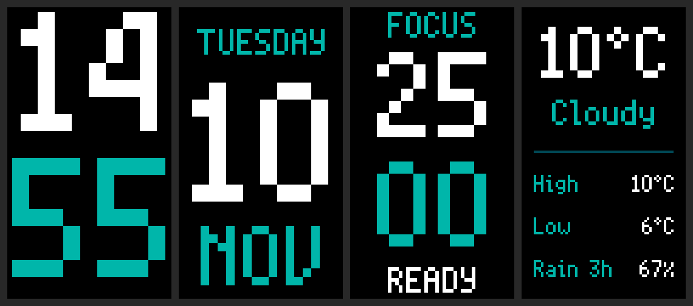

# picoWClock (PIM543 variant)

Desk clock on a Raspberry Pi Pico 2 W + Pimoroni Display Pack 1.14"
(PIM543, 240x135), portrait, one screen per button:

White with a teal accent throughout.



- **A** clock (default): hours white on top, minutes teal below, each
  scaled to fill its half of the panel.
- **B** date: weekday, day number, month.
- **X** focus timer, 25 minutes: press X again to start or pause; on the
  timer screen, hold X for a second to reset (from any other screen a
  long press only shows the timer, so it cannot wipe a session unseen).
  At zero it switches itself to the timer screen and flashes teal for
  6 s, then reads DONE, and the RGB LED glows teal until any button is
  pressed (or 30 minutes pass).
- **Y** London weather from Open-Meteo (free, no key): current
  temperature large (e.g. `10°C`), the condition in words (Sunny,
  Partly cloudy, Rain, ...; Clear at night), a divider, then today's
  High and Low, and `Rain 3h`: the highest hourly chance of rain over
  the next three hours. Refreshes every 15 minutes; press Y
  again to refresh (it fetches once the buttons have been left alone for
  3 s). A reading older than 3 hours shows `No data`.

Any screen other than the clock returns to it after 20 s without a press,
except while the timer is running. Time comes from NTP with UK GMT/BST
handling. From 22:00 to 07:00 UK time the backlight dims (0.55 to 0.15)
and the finished-timer glow is dimmer too; the hours and levels are
constants at the top of `main.py`.

A, B and Y switch screens the moment they go down; X acts on release,
because a hold means reset. Buttons are stamped by a hardware interrupt
and handled in the order pressed, so no press is lost or reordered even
while a network call holds the loop, and contact bounce never counts one
press twice. Network work (weather, NTP, WiFi rejoin) waits until the
buttons have been quiet for 3 s, and background WiFi rejoins never block.
All timing uses a non-wrapping millisecond count, so nothing stalls after
the board's tick counter wraps (every 12.4 days).

If anything unexpected goes wrong the clock writes the error to
`crash.txt` on the board (the latest one only, with the UK time and
uptime) and restarts itself, rather than freezing on a wrong time.
Read it with `mpremote connect "$TTY" cat :crash.txt`. NTP replies are
checked (server mode, stratum, leap flag, plausible year) before the RTC
is set.

Forked from chriskalv/picoWClock (Display Pack 2.0, used as the NTP, DST
and layout starting point) and adapted by Beltsazar Krisetya,
November 2026. Divergence from upstream:

- PicoGraphics `DISPLAY_PICO_DISPLAY` (240x135) rotated 270 degrees, hold
  the board with USB at the top. Font is `bitmap8` at integer scales: the
  pico2_w Pimoroni build ships no vector fonts.
- WiFi credentials moved out of `main.py` into `WIFI_CONFIG.py`
  (git-ignored; copy `WIFI_CONFIG.py.example` and fill it in). It holds a
  `NETWORKS` list; the clock scans and joins whichever one is in range, so
  one config works at home and at work.
- RTC stays in UTC; BST is applied at render time (last Sunday March
  01:00 UTC to last Sunday October 01:00 UTC).
- The board has no battery-backed clock: after any power loss it shows
  `-- / --` until it reaches a known network and NTP.
- Failed WiFi/NTP no longer demands a reboot: background rejoins cycle
  through the known networks without blanking the face or blocking the
  buttons, and NTP resyncs every 6 hours.
- The pack's RGB LED is driven off at boot (unconfigured, the GPIO
  pull-downs make the red die glow).

## Test on the host

```sh
python3 tests/host_sim.py
```

Runs the real `main.py` under CPython against stubbed board modules
(buttons, display, WiFi, NTP, and the recorded Open-Meteo response in
`tests/open_meteo_sample.json`) and walks every screen and timer path,
night dimming, the LED glow, bad NTP replies, the crash guard and eight
untouched days, with the tick counter crossing its wrap. Text widths come from the
board's own font metrics (`tests/bitmap8_widths.json`), so layout fits are
checked against real pixels. Run it before every deploy.

## Deploy

```sh
TTY=$(readlink -f /dev/serial/by-id/usb-MicroPython_Board_in_FS_mode_*-if00)
mpremote connect "$TTY" cp main.py :/main.py
mpremote connect "$TTY" cp WIFI_CONFIG.py :/WIFI_CONFIG.py
mpremote connect "$TTY" reset
```

Resolve the port through `/dev/serial/by-id` each time: a hard reset
re-enumerates USB and the ttyACM number can change.

First flash of Pimoroni MicroPython (pico2_w UF2) can be done with no
BOOTSEL press from a running REPL via `mpremote exec "import machine;
machine.bootloader()"`. Canonical copy of this project:
`~/work/pico-clock` on sm-pi.
